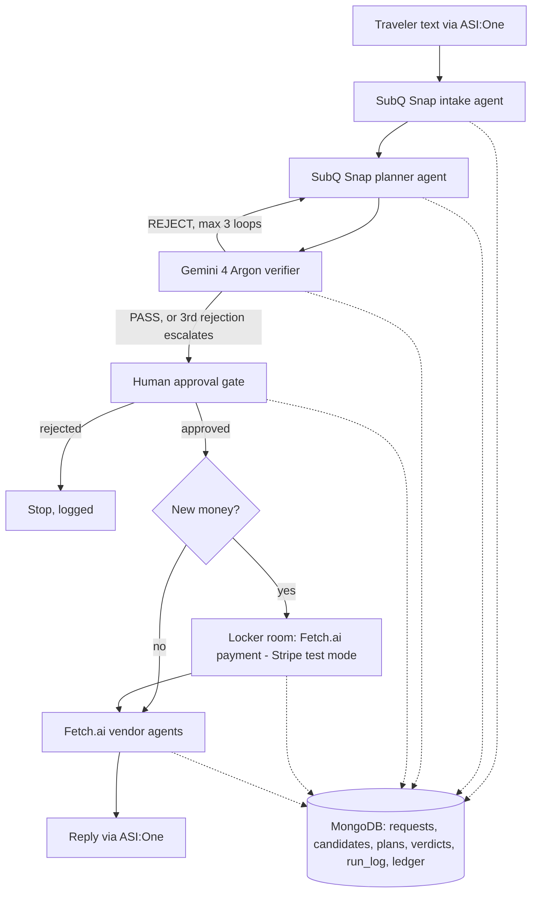

# TripCheck

**A travel agent you can trust with your money.** You chat in ASI:One. SubQ Snap structures your request and plans the trip. Gemini 4 Argon independently verifies the plan, for at most 3 loops. You approve. The locker room pays only when new money goes out, and Fetch.ai agents execute. Every step is timed and costed.

AIE Code Summit Hackathon, Nov 7, 2026 · Track: Trust but Verify

- **Spec (start here):** [`SPEC.md`](SPEC.md)
- **Visual system design / pitch:** [`docs/tripcheck-build-spec.html`](docs/tripcheck-build-spec.html) (open in a browser)

## Architecture



Every request, candidate set, plan, verdict, log line and ledger entry lands in MongoDB, so the whole run is auditable end to end.

## Sponsor tech

- **Fetch.ai (Agentverse + ASI:One)** - the agent framework. ASI:One carries the traveler conversation in and out; Fetch.ai uAgents run the payment step and the vendor booking step and talk over the Agent Chat Protocol and Agent Payment Protocol.
- **SubQ Snap** - the intake and planner agents. Structured decision calls turn free text into a request and candidates into a plan.
- **Google Gemini 4 Argon** - the verifier agent. Independent structured review of each plan against the stored request and candidates, returning a typed PASS/REJECT verdict.
- **MongoDB Atlas** - the single source of truth. Collections: `requests`, `candidates`, `plans`, `verdicts`, `run_log`, `ledger`. Agents read and write state only here; the run log records what was checked, when, and the result.
- **Stripe (test mode)** - payments inside the locker room. Test keys only; no real charges.

## Run it now (no keys needed)

```bash
pip install -r requirements.txt
python run_local.py
```

This runs the whole flow on mock data with an in-memory MongoDB:

```
⚡ ready → ⚡ check v1 → ⚡ replan v2 → ⚡ check v2 → ⚡ pass v2
What the verifier caught:
- v1 R-20 cheaper_equivalent: $800 vs $900, same day, departs 11:40 vs 11:00
- v1 R-20 cheaper_equivalent: $60 vs $120, same area, rating 4.5
→ approve → ⚡ pay → ⚡ execute → booked
```

To see the worst case (3 loops, then approval blocked), run `python run_local.py "Japan Nov 15-22, Tokyo then Osaka, budget $1,500"`.

Copy `.env.example` to `.env` and fill in a key to switch that part to the real API. Empty keys stay on the mock.

### Chat in the terminal (real APIs from .env)

```bash
DEMO_NOW=2026-11-18T10:00:00 python chat.py
```

Type a trip request, then `approve`. Follow-ups go to the same trip ("Stay 2 more nights in Osaka", "Cancel my Osaka hotel"). `/trip` shows bookings and payments.

### Run the real system (ASI:One chat + Fetch.ai agents)

```bash
AGENTS_USE_MAILBOX=true python -m orchestrator.agent
```

This runs the orchestrator (with a mailbox for ASI:One) and the five booking agents in one process. It prints the orchestrator address; open it on Agentverse and use "Chat with Agent". In chat: describe a trip → **approve** → it books. Then try "Stay 2 more nights in Osaka", "Cancel my Osaka hotel" or "Cancel the whole trip". You need `AGENT_SEED_PHRASE` set to your own secret first.

### All tests (offline, about 2 minutes)

```bash
python -m pytest -q tests/test_intake.py      # P1 intake
python -m tests.test_p2_verifier              # P2 verifier + gate
python -m tests.test_p3_inprocess             # P3 policy + locker room
python -m tests.test_e2e_chat                 # one conversation through the whole pipeline
python run_booking_local.py                   # booking agents: book/reschedule/extend/cancel/failsafe
python run_booking_local.py tamper            # vendor overcharge refused
python -m tests.test_asi_chat_agents          # chat protocol → orchestrator → Fetch agents → chat
```

## Demo walkthrough

1. `pip install -r requirements.txt`, then `python run_local.py` - the full flow on mock data: the planner proposes v1, the verifier catches cheaper equivalents, the plan is revised, and v2 passes.
2. Show the rejection path: `python run_local.py "Japan Nov 15-22, Tokyo then Osaka, budget $1,500"` runs the worst case - 3 verify/replan loops, then approval is blocked and it escalates.
3. Approve the passing plan at the human gate. The approval words are approve / confirm / book it / go ahead.
4. Show the payment path: `python run_booking_local.py` exercises book → reschedule → extend → cancel, and `python run_booking_local.py tamper` shows the locker room refusing a vendor that overcharges by $500.
5. Walk the audit trail in MongoDB: one request, its candidates, each plan version, every verdict, the run log, the ledger.

## Who owns what

| Person | Owns | Files | Replace the mock with |
|---|---|---|---|
| **P1** | ASI:One agent, ① Intake, ② Planner, the loop | `orchestrator/`, `intake/`, `planner/` | real SubQ Snap calls (`intake/subq_client.py`), then run `python -m orchestrator.agent` and test "Chat with Agent" |
| **P2** | ③ Verifier, ④ Human gate | `verifier/`, `gate/` | Gemini 4 Argon review (`verifier/verifier.py`), plus refund rule R-12 |
| **P3** | ⑤ Locker room, ⑥ Fetch agents | `locker/`, `vendors/` | Fetch payment protocol + Stripe **test** (`locker/locker.py`), vendor uAgents (`vendors/agents.py`) |
| Shared | contracts, db, signals, metrics, seed | `common/`, `seed/` | Change only with the team's agreement |

**Rule:** keep your function signatures and the shapes in `common/contracts.py`. Then everyone's parts keep working together.

## P2: Verifier + human gate

- **`verifier/checks.py`** holds the deterministic rules R-01, R-04, R-05, R-09, R-12, R-13, R-14 and R-20 (see `SPEC.md` §4). They run on book plans and on change plans; for a change, they check the trip as it will be after the change.
- **`verifier/verifier.py`** adds the Gemini 4 Argon review (JSON schema, thinking level, token and cost logging). Replacements Gemini makes up are dropped. If Gemini is unavailable, the verdict is rules-only. Decision: REJECT on a hard issue or a fixable soft issue, otherwise PASS with heads-ups.
- **`gate/gate.py`** builds the approval message. For change plans it shows what changes, refunds to your card, and "You pay now". The approval words are approve / confirm / book it / go ahead, and "approve the cancel" counts. A plan can't be approved if it has a hard failure, has no verdict, or was already approved.

```bash
python -m tests.test_p2_verifier     # 25 checks, offline
MOCK=subq python run_local.py        # same flow with real Gemini 4 Argon (needs GEMINI_API_KEY)
```

## P3: Booking agents on Fetch.ai (locker room + vendors)

Five uAgents. Payments use Fetch.ai's standard **Agent Payment Protocol** (`uagents_core.contrib.protocols.payment`):

```
orchestrator ──ExecutePlan──▶ coordinator ──VendorOrder──▶ flight / hotel / dining vendor
                                                              │ RequestPayment ▼
                                                          locker room: checks the approved plan in MongoDB
                                                              │ CommitPayment / RejectPayment ▲
orchestrator ◀─PlanExecuted── coordinator ◀─VendorResult── vendor books → ledger → CompletePayment
```

The locker room pays a vendor only if the plan is approved, the plan hash matches, the items are in the plan and belong to that vendor, the amount equals the plan's cost for those items, and the total stays within `money_delta_usd`. Repeat requests are never charged twice.

```bash
python run_booking_local.py          # book → reschedule → extend → cancel → failsafe (14 checks)
python run_booking_local.py tamper   # hotel vendor overcharges by $500 → the locker room refuses
python -m tests.test_p3_inprocess    # refund policy, locker room refusals, changes without agents
python -m vendors.agents             # run the 5 agents; prints the coordinator address
```

**Mid-trip changes.** Each change is a plan of `Action`s that goes through the same verify → approve loop:

| Change | Actions (build them with `vendors/policy.py`) | Money |
|---|---|---|
| Cancel | `cancel_action(trip, booking_id)`: refund from the vendor's policy | no locker room; refund to the original card |
| Reschedule | `shift_hotel_action(trip, id, days)`, `change_flight_action(trip, id, new_flight)` | pays only the change fee + fare difference |
| Extend | `extend_hotel_action(trip, id, nights)` (+ `change_flight_action`) | pays only the extra nights + fee |

- Vendors run books and changes first and cancels only after those succeed, so a failed change never loses the old booking.
- Every action is checked before any money moves.
- At cancel time the vendor recomputes the refund from its own policy. If that differs from the plan, the chat message flags it.
- P2: rule R-12 can call `policy.refund_for(booking)` to check a plan's refund.
- For mid-trip demos, set `DEMO_NOW=2026-11-18T10:00:00`.

**Interface for P1.** After the user says "approve" and `gate.approve()` has stored `plan_hash`, the orchestrator sends one message and gets one back. It does not send the ⚡ pay signal itself; vendors ask the locker room directly.

```python
from vendors.protocol import ExecutePlan, PlanExecuted
await ctx.send(COORDINATOR_ADDRESS, ExecutePlan(trip_id=..., version=..., plan_hash=...))

@agent.on_message(PlanExecuted)
async def done(ctx, sender, m: PlanExecuted):
    ...  # post m.summary to the ASI:One chat
```

To run everything in one process, add the orchestrator agent to the same `Bureau` as `vendors.agents.build_agents()`. Set `AGENTS_USE_MAILBOX=true` on a laptop with internet to register the agents on Agentverse. You must first set `AGENT_SEED_PHRASE` to your own long random secret; the default seed is public.

## Layout

```
common/        contracts.py (all data shapes) · db.py · signals.py · metrics.py · config.py
seed/          seed_japan.py: synthetic Japan trip (flights, hotels, dining, events)
intake/        ① subq_client.py · intake.py
planner/       ② planner.py (new trips) · changes.py (cancel / reschedule / extend)
verifier/      ③ checks.py (Python rules) · verifier.py (Gemini review + loop decision)
gate/          ④ gate.py (approval message, scoreboard, plan hash)
locker/        ⑤ locker.py (payment checks + charge) · agent.py (locker room uAgent, payment protocol buyer)
vendors/       ⑥ vendors.py (book/modify/cancel → ledger) · policy.py (refunds, change actions) · agents.py (coordinator + vendor uAgents) · protocol.py (messages)
orchestrator/  pipeline.py (the loop) · agent.py (ASI:One chat agent → Fetch booking agents)
run_local.py   end-to-end run with mocks (in-process)
run_booking_local.py  P3 test: real uAgents + payment protocol, offline
tests/         test_intake.py · test_p2_verifier.py · test_p3_inprocess.py · test_e2e_chat.py · test_asi_chat_agents.py
```

## Check first (15 min)

- SubQ: call `GET /v1/models` to get the exact Snap model ID, and check the request shape against the [Decisions API docs](https://docs.subq.ai/endpoints/decisions-api/).
- Gemini: confirm your key can call Argon, then set `GEMINI_MODEL`.
- Agentverse: confirm a mailbox agent opens in "Chat with Agent". See the [chat protocol docs](https://docs.agentverse.ai/documentation/getting-started/enable-chat-protocol).

All data is synthetic. Nothing books or charges anything real.

## Limitations

- Hackathon prototype built in one day. It proves the verify-before-execute loop; it is not a production travel product.
- All data is synthetic and seeded; there is no live flight or hotel inventory, and nothing books or charges anything real.
- Payments run on Stripe test mode only, inside the locker room's checks.
- The approval gate is a single-operator surface, not a multi-user product.

## Team

- Ahmad Sultan
- Bao
- Chris D
