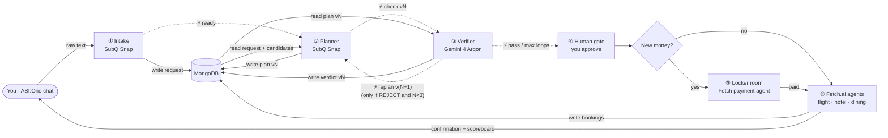

# TripCheck: Final Spec (locked)

> AIE Code Summit Hackathon · Nov 7, 2026 · Track: **Trust but Verify**
> This file is the single source of truth. Ask the team before changing a contract in `common/`.

TripCheck is a travel agent you can trust with your money. You chat in **ASI:One**. **SubQ Snap** turns your message into a structured request and picks the plan. **Gemini 4 Argon** verifies it independently, in up to **3 loops**. You approve. The **locker room** pays only when new money goes out, and **Fetch.ai** agents execute. Every step is timed and costed.

---

## 1. Architecture

MongoDB sits in the middle. Steps never pass data directly to each other. Each step:

1. **reads** its input from MongoDB
2. **works**
3. **writes** its result + a `run_log` entry (time, tokens, cost) to MongoDB
4. **sends a signal** to the next step: IDs only, never data, amounts or card details



The rendered diagram and pitch material are in [`docs/tripcheck-build-spec.html`](docs/tripcheck-build-spec.html). Open it in a browser.

---

## 2. Tech, and what each piece is used for

| Piece | Used for | Notes |
|---|---|---|
| **ASI:One** (via Agentverse) | Chat UI. We build no frontend. | The orchestrator uAgent uses the Agent Chat Protocol with `mailbox=True`, which adds a "Chat with Agent" button on Agentverse. |
| **SubQ Snap 1.1** | ① Intake + ② Planner | A **decision model**: `POST https://api.subq.ai/v1/systemone` with a `state` (≤384K tokens) and 1–16 `questions`. Answers are yes/no probabilities, **choice** (2–255 options, probability for each, confidence) or score. **Output tokens = 0**, so it can't write text or JSON. Our code builds the JSON from its answers. |
| **Gemini 4 Argon** | ③ Verifier | Returns JSON via `response_schema`. Read token counts from `usage_metadata`. Hard math is done in Python, not by the model. |
| **MongoDB** | Single source of truth + run log | Falls back to `mongomock` when `MONGODB_URI` is empty, so everything runs locally. |
| **Fetch.ai** | ⑤ Locker room (payment protocol, Stripe **test** mode) + ⑥ vendor agents | The card never appears in any prompt or message. |

### Check in the first 15 minutes
- [ ] SubQ: `GET https://api.subq.ai/v1/models` to see which model ID your key gets: `subq-snap-1.1` or `subq-snap-preview`. Then check the exact `questions` request shape against https://docs.subq.ai/endpoints/decisions-api/ and fix `intake/subq_client.py` if it differs.
- [ ] Gemini: your key can call Argon. Set `GEMINI_MODEL` (fall back to the best Pro model you have).
- [ ] Agentverse: a hello-world mailbox agent opens in "Chat with Agent".
- [ ] Ask at the SubQ booth whether they can enable `subq-1.4-small` (text generation) for our org.

---

## 3. The steps

| # | Step | Owner | Wakes on | Reads | Does | Writes → then signals |
|---|---|---|---|---|---|---|
| ① | Intake | **P1** | chat message | `ledger` (for changes) | SubQ fixed questions: `intent`, `city`, `target_booking`, `budget_tier`, `pace`, `dining_style`. Dates and numbers come from a parser. | `requests` + `run_log` → `⚡ ready` |
| ② | Planner | **P1** | `ready` / `replan` | `requests`, `candidates`, `ledger`, previous `verdicts` | One SubQ **choice** question per slot, with every candidate as an option. Applies verifier replacements. | `plans` vN (PlanPackage) + `run_log` → `⚡ check vN` |
| ③ | Verifier | **P2** | `check vN` | `plans` vN, `requests` (incl. raw text), `candidates` | Python checks first, then Gemini review | `verdicts` vN + `run_log` → `⚡ replan` or `⚡ pass` |
| ④ | Human gate | **P2** | `pass` / max loops | final `plans` + all `run_log` | Shows the plan + scoreboard in chat. Parses "approve". | `plans.approved`, `plan_hash` → `⚡ pay` or `⚡ execute` |
| ⑤ | Locker room | **P3** | `pay` | approved plan (reads the amount itself) | Checks `approved` + `plan_hash`, pays exactly `money_delta_usd` (Stripe test) | `ledger.payments` → `⚡ execute` |
| ⑥ | Execute | **P3** | `execute` | approved plan actions | Vendor agents book, cancel or rebook | `ledger.bookings` → reply in chat |

---

## 4. The verification loop (max 3)

```
version = 1
loop:
    planner  → writes plans vN
    verifier → writes verdicts vN
    if PASS           → go to human gate now (skip any remaining loops)
    if N == 3         → stop looping, go to human gate with the BEST version
    else              → planner makes v(N+1) using the verdict
```

- **Pass on the first try** → straight to the human gate. No extra loops.
- **Worst case is 3 plan versions and 3 verdicts**, then we must answer the user.
- **After 3 loops without a PASS**, the human gate shows the best version: fewest **hard** failures first, then lowest cost. It lists the remaining issues.
  - **Hard** rule still failing (budget exceeded, overlapping nights, flight/hotel misaligned, wrong refund, event not covered): the user **cannot approve**. They can change the request or cancel.
  - Only **soft** issues left (e.g. a cheaper equivalent exists): the user may approve anyway.
- Every loop is logged, and the scoreboard shows time and cost per model per loop, plus the money the verifier saved.

### Verifier rules (Python, deterministic)

Rules check the trip **as it will be after the plan runs**. For a book plan that's the picks. For a change plan, it's the active bookings with the actions applied.

| Rule | Severity | Check |
|---|---|---|
| `R-01 budget` | hard (soft for changes) | trip total ≤ budget |
| `R-04 events_covered` | hard* | you're in the event's city on the event's date |
| `R-05 no_overlap` | hard* | every night between the flights has exactly one hotel |
| `R-09 flights_match_hotels` | hard* | outbound = first check-in, return = last check-out (book plans: also = requested dates) |
| `R-12 refund_matches_policy` | hard | a cancel's expected refund = vendor policy refund (`vendors/policy.py`) |
| `R-13 change_price_matches` | hard | a change's price = vendor policy price |
| `R-14 targets_exist` | hard | changed/cancelled bookings are active on this trip; new items exist |
| `R-20 cheaper_equivalent` | soft | the same slot has an option ≥10% cheaper, same date, departure within 90 min (flights) or same area and rating within 0.2 |

\* Soft when the traveller asked to cancel. Gaps they asked for are shown as heads-ups, not blocks.

**Decision:** REJECT if there's any hard issue, or any soft issue that comes with a concrete replacement. Otherwise PASS, and remaining soft issues are shown as heads-ups. This way no loop is spent on something the planner can't fix.

**Loops are counted per request.** Intake stores `first_version`, and a change request continues the trip's version numbers (v1, v2 for the booking; v3, v4… for a later change). The 3-loop limit counts from `first_version`, and earlier plans are never overwritten.

Gemini 4 Argon adds a review on top: fit with **your raw text**, low-confidence picks, anything the rules missed. Its issues are always soft. A replacement it suggests is kept only if it's a real candidate in the same slot; otherwise the note stays and the fix is dropped. If Gemini is down, the verdict is rules-only and says so. `VERIFIER_THINKING_LEVEL` = off | low | medium | high. With medium, a call took about 6–8 s and cost about $0.008 in testing.

---

## 5. Money routing

| Intent | Money | Path after approval |
|---|---|---|
| Book | new money | locker room → Fetch |
| Cancel | refund to original card | Fetch directly (no vault) |
| Reschedule | Δ > 0: pay only Δ. Δ ≤ 0: refund | locker room if Δ > 0, else Fetch directly |
| Extend | new money (extra nights + flight change fee) | locker room → Fetch |

Reschedule order: **book the new option first, then cancel the old one.**

---

## 6. Signals (IDs only)

```json
{ "type": "ready",   "trip_id": "JP-1115" }
{ "type": "check",   "trip_id": "JP-1115", "version": 1 }
{ "type": "replan",  "trip_id": "JP-1115", "version": 2 }
{ "type": "pass",    "trip_id": "JP-1115", "version": 2 }
{ "type": "max_loops","trip_id": "JP-1115", "version": 3 }
{ "type": "pay",     "trip_id": "JP-1115", "version": 2, "plan_hash": "9f3c…" }
{ "type": "execute", "trip_id": "JP-1115", "version": 2, "payment_id": "pay_…" }
```

Defined in `common/contracts.py` (`Signal`). **The signal to the locker room carries no amount.** The locker room reads the amount from the approved plan in MongoDB and checks the hash.

---

## 7. MongoDB collections

| Collection | Written by | Key fields |
|---|---|---|
| `requests` | ① | `trip_id, raw_text, intent, cities, start, end, budget_usd, events, prefs, target_booking` |
| `candidates` | seed | `id, kind (flight/hotel/dining), slot, city, date, price_usd, …` |
| `plans` | ② (approval fields by ④) | PlanPackage: `trip_id, version, slots[], actions[], total_usd, money_delta_usd, plan_hash, approved` |
| `verdicts` | ③ | `trip_id, version, result, checks[], issues[], replace{}, hard_failures` |
| `run_log` | every step | `trip_id, step, loop, version, model, ms, input_tokens, output_tokens, cost_usd` |
| `ledger` | ⑤ ⑥ | `type: booking|payment|refund, trip_id, …` |

All schemas are pydantic models in `common/contracts.py`.

---

## 8. Mid-trip changes (same loop)

| Intent | You say | Planner decides | Verifier checks |
|---|---|---|---|
| Cancel | "Cancel my Osaka hotel" | which booking. Suggest a free date change instead? | refund = policy math, right booking ID |
| Reschedule | "Move Kyoto two days later" | new option per affected slot | no overlap, events covered, fee vs rebook |
| Extend | "2 more nights in Osaka" | same hotel or alternative + new return flight | return flight = new end date, nights continuous, budget |

The starter code implements **book** end to end. Cancel, reschedule and extend reuse the same pipeline. Add them after the book flow works.

---

## 9. Team split (3 people)

| Person | Owns | Folders | Done when |
|---|---|---|---|
| **P1** | ASI:One agent + Intake + Planner + loop | `orchestrator/`, `intake/`, `planner/` | A message in ASI:One produces `requests` and `plans` v1 in Mongo, using real SubQ calls |
| **P2** | Verifier + Human gate + scoreboard | `verifier/`, `gate/` | Real Gemini verdicts. A REJECT triggers v2. The approval message shows the scoreboard. |
| **P3** | Locker room + Fetch agents | `locker/`, `vendors/` | Payment via Fetch payment protocol (Stripe test). Vendor uAgents write to the ledger and reply. |

**Shared (`common/`, `seed/`)**: contracts, db, signals, metrics and seed data. Change these only with the team's agreement.

Everyone starts from a working pipeline. `python run_local.py` runs the whole flow on mock data with no API keys. Replace your mock with the real thing and keep the function signatures.

## 10. Timeline

| Time | What |
|---|---|
| 0:00–0:15 | Run `run_local.py`. Do the checks in section 2. |
| 0:15–1:30 | Each person replaces their mocks with real calls |
| 1:30–2:15 | Integrate in ASI:One: book flow first, then cancel, then extend |
| 2:15–2:45 | Rehearse the demo and record the 1-minute video |

## 11. Demo script

1. "Japan Nov 15–22, Tokyo then Osaka, budget $3,500" → plan v1 → **verifier rejects the $900 flight, finds the $800 one** → v2 PASS → scoreboard → approve → locker room pays → booked.
2. "Cancel my Osaka hotel" → refund checked against the policy → approve → **no card used** → refund confirmed.
3. "Stay 2 more nights in Osaka" → verifier catches the return flight that wasn't moved → fixed → the vault pays only the extra.

All demo data is synthetic. No real bookings or payments.
